# Neural Networks — Haberman Survival
## Project Report

## 1. Introduction

This project was developed for a university course in **Neural Networks** and studies supervised and unsupervised learning using **Haberman's Survival Dataset**.

The main objective is to construct and train a feed-forward neural network for classification, experiment with different network and training configurations, and then investigate the same dataset using competitive neural-network techniques.

The GitHub version preserves the original educational scope of the project while correcting issues that affected reproducibility and evaluation.

---

## 2. Dataset

The project uses **Haberman's Survival Dataset**.

The dataset contains **306 patient records** and the following three input features:

1. Age of the patient at the time of operation
2. Year of operation
3. Number of positive axillary nodes detected

The target variable is the patient's survival status:

- Class `1`: patient survived for 5 years or longer
- Class `2`: patient died within 5 years

The dataset contains no missing values.

The first exploratory step visualizes relationships between the three input features using a scatter matrix.

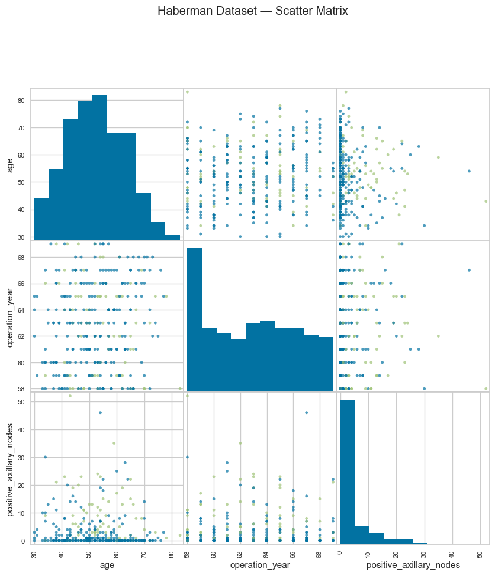

Feature distributions are also examined using box plots.

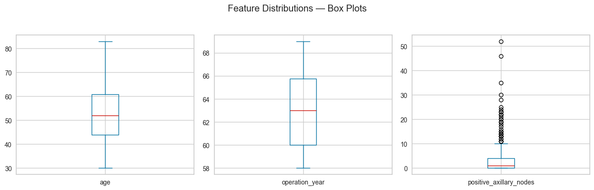

---

## 3. Data Preparation

The three input features are separated from the target class.

For the feed-forward neural network, the two classes are represented with two output neurons using one-hot encoding:

- Class `1` → `[1, 0]`
- Class `2` → `[0, 1]`

The dataset is initially split into:

- 70% training data
- 30% test data

The input features are normalized with `MinMaxScaler`.

To avoid information leakage, the scaler is fitted only on the training data and then applied to the corresponding test data.

---

## 4. Initial Feed-Forward Neural Network

The initial network uses the following configuration:

| Parameter | Value |
|---|---:|
| Hidden neurons | 5 |
| Output neurons | 2 |
| Activation | Logistic sigmoid |
| Training algorithm | RPROP |
| Learning rate | 0.3 |
| Maximum epochs | 3000 |
| Performance goal | 1e-5 |
| Train/Test split | 70/30 |

The training error curve is shown below.

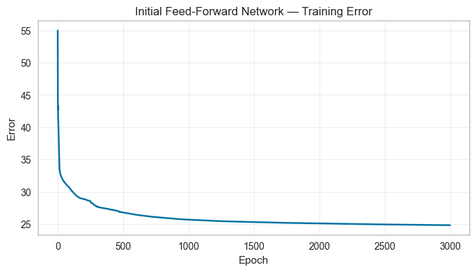

The initial network achieved approximately:

**Test accuracy: 71.74%**

The test-set predictions were compared directly with the true survival classes.

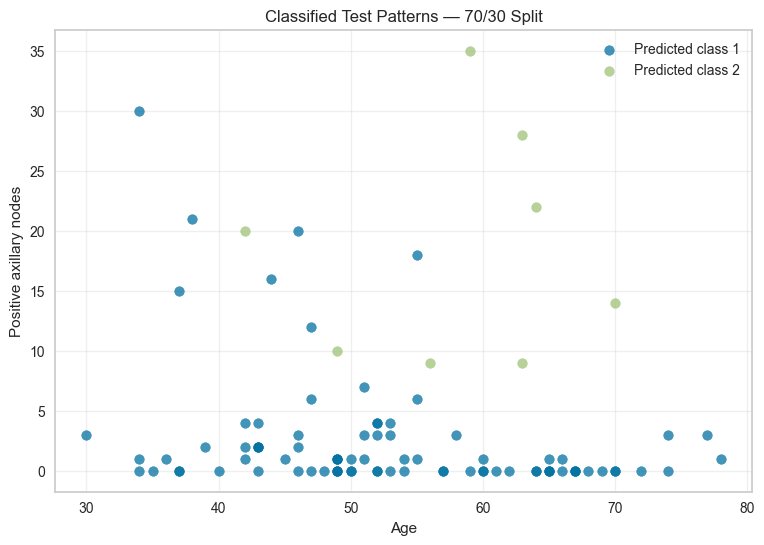

---

## 5. Network Configuration Experiments

To investigate the effect of architecture and training parameters, several configurations were tested by changing:

- hidden neurons,
- learning rate,
- number of epochs.

Each experiment starts with a newly initialized network so that the comparisons remain independent.

The full results are stored in:

```text
results/tables/02_architecture_experiments.csv
```

Training-error curves for the tested configurations are included below.

### Initial configuration

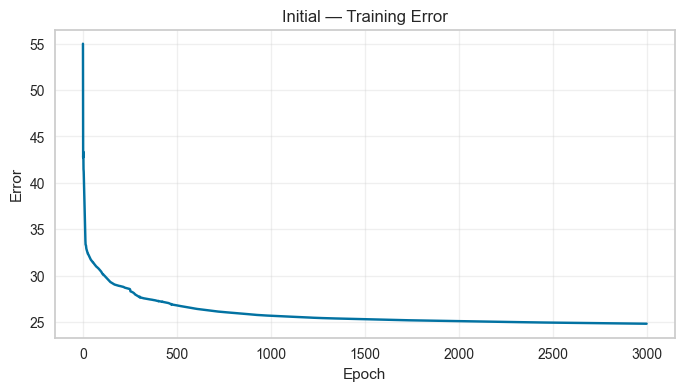

### Change 1

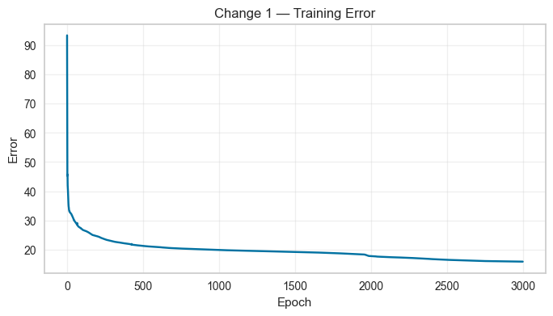

### Change 2

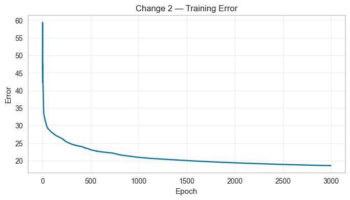

### Change 3

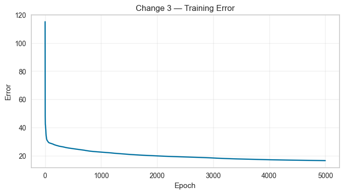

The experiments demonstrate that neural-network performance is affected by both architecture and training parameters, and therefore these parameters should be evaluated rather than selected arbitrarily.

---

## 6. Train/Test Split Experiments

The selected network configuration was also evaluated using different dataset splits:

- 50% training / 50% test
- 60% training / 40% test
- 70% training / 30% test
- 80% training / 20% test
- 90% training / 10% test

For every split:

1. a new train/test partition is created,
2. the scaler is fitted only to the training set,
3. a new neural network is initialized,
4. the network is trained only on the training samples,
5. accuracy is measured only on the test samples.

The results are stored in:

```text
results/tables/03_train_test_split_experiments.csv
```

The accuracy comparison is shown below.

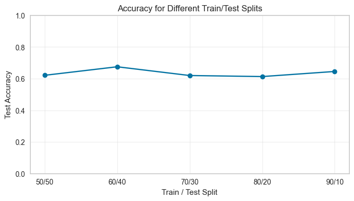

These experiments show that the train/test ratio affects both the amount of data available for learning and the size of the independent evaluation set.

---

## 7. Unsupervised Learning

For the unsupervised part of the project, the survival-status column is removed.

Only the three input features are used.

### 7.1 Silhouette Analysis

K-Means clustering is tested with different numbers of clusters and evaluated with the silhouette score.

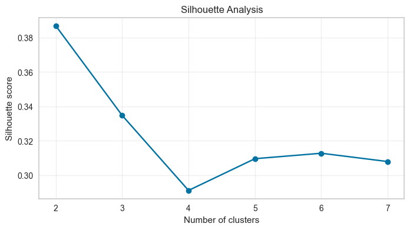

The highest silhouette score is obtained with:

**2 clusters**

The numerical results are stored in:

```text
results/tables/04_silhouette_scores.csv
```

### 7.2 Elbow Method

The elbow method is also used as an additional visual method for investigating the number of clusters.

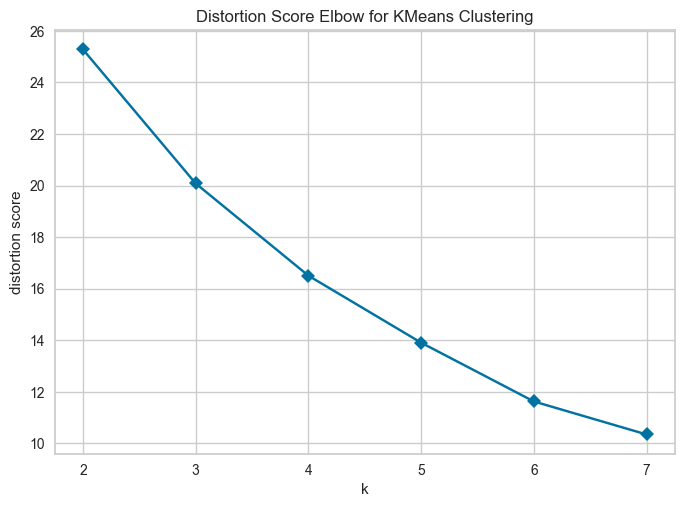

The clustering analysis supports the use of two groups for the competitive neural-network stage.

---

## 8. Competitive Neural Network

A competitive neural network is created using the normalized input features.

Two training algorithms are evaluated:

- Winner-Take-All (WTA)
- Conscience Winner-Take-All (CWTA)

### WTA Training

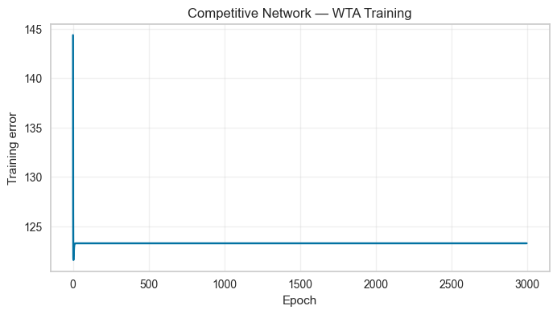

### CWTA Training

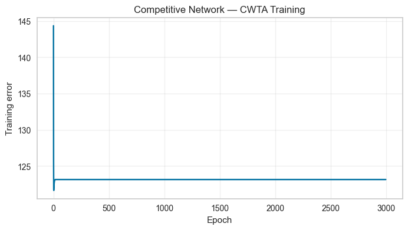

The final cluster assignments are visualized using age and the number of positive axillary nodes.

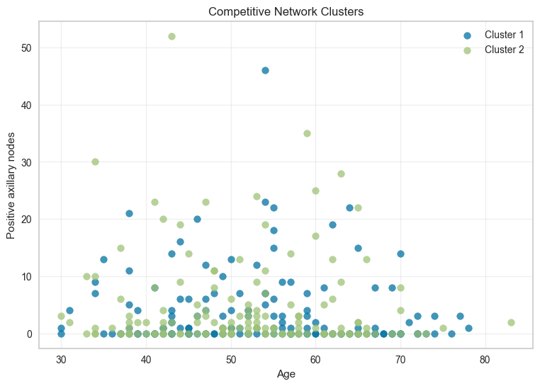

This stage provides an unsupervised view of the dataset, in contrast to the supervised survival-status classification performed by the feed-forward network.

---

## 9. Discussion

The project demonstrates several important aspects of constructing a neural-network workflow.

Correct preprocessing is essential. Features should be separated from the target variable, normalization should be learned only from the training set, and evaluation must use samples that were not used during training.

The experiments also show why network architecture and training parameters matter. Changing the number of neurons, learning rate, or training duration can alter convergence and classification performance.

Train/test split selection also influences the results. Larger training sets provide more examples to the model, while larger test sets provide a more stable independent evaluation.

Finally, the unsupervised experiments demonstrate that competitive neural networks can identify structure in the input space without using the known survival class.

---

## 10. Conclusion

This university project combines supervised and unsupervised neural-network methods on Haberman's Survival Dataset.

The implementation covers:

- data exploration,
- preprocessing,
- feed-forward neural networks,
- training-parameter experiments,
- train/test evaluation,
- cluster-number selection,
- competitive neural networks,
- WTA and CWTA training.

The most important conclusion is that the quality of a neural-network experiment depends not only on the network architecture but also on correct data preparation and evaluation methodology.

The project remains intentionally close to the original university implementation and serves as a documented example of classic neural-network experimentation in Python.

---

### Execution Environment

Full notebook execution time on the development system: **17 min 39.21 sec**.